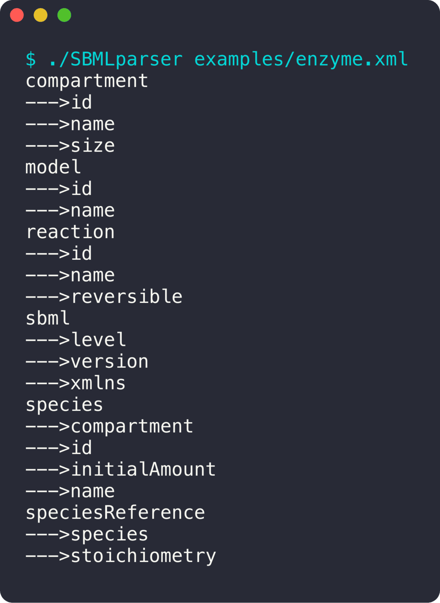

<div align="center">

# SBMLparser

**Un parseur XML maison pour des modèles de biologie (SBML).**

 

<sub>Projet solo · 2023</sub>

</div>

<br/>

<p align="center"></p>

## En deux mots

Le **SBML** est le format XML qui décrit des réactions biochimiques. Le programme lit un fichier SBML sans aucune bibliothèque XML et en affiche la structure : chaque balise et ses attributs, triés.

## Ce que ça fait

- Parseur XML écrit à la main : balises, attributs, balises auto-fermantes
- Liste triée des balises et de leurs attributs
- Modèle d'exemple (cinétique enzymatique) dans [`examples/`](examples)

## Sous le capot

Le fichier est lu en entier, puis découpé en balises. Chaque nom de balise est associé à l'ensemble de ses attributs, sans doublons, avant d'être trié et affiché.

## Lancer le projet

```bash
make
./SBMLparser examples/enzyme.xml
```
